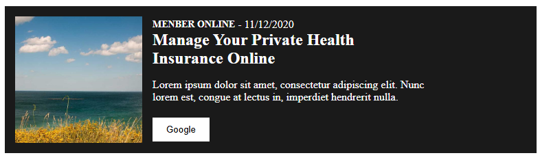
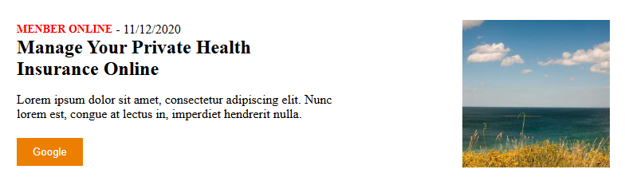
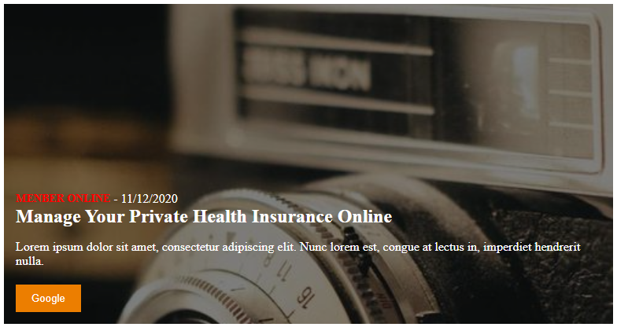
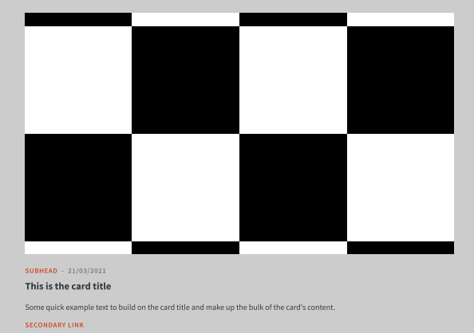
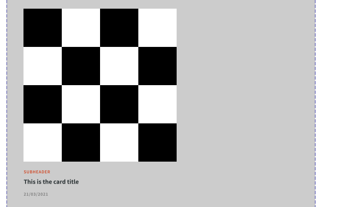

# AXA Lit Card Component

This project was made as an exercice for an interview. It contains a card component that follows the specifications of th AXA design system using Lit to render it and Storybook to demo it. The whole project was built with React Vite and unit tested with Jest.
Here are some examples of the rendered component with different props.

- Medium image in dark mode
<p></p>
- Medium image in light mode inverted
<p></p>
- Background image in light mode
</p></p>


## Dev talk (French)
- J’ai rencontré ma première difficulté lors de l’installation de Lit avec le framework React/Next.js. Au lancement en mode développement, le programme retournait des erreurs concernant la déclaration des propriétés à l’aide de décorateurs, par exemple @property({ type: Number }). J’ai donc opté pour Vite, qui acceptait les deux types de déclarations : avec décorateurs et avec une syntaxe standard.

- J’ai relevé une ambiguïté dans le document des requirements, plus précisément concernant le rendu de la Card avec une image en taille lg. Les deux captures d’écran ci-dessous illustrent ce qui me semble être deux layouts possibles pour une image lg, sans que je puisse déterminer le cas d’utilisation de chacun. En temps normal, ce point aurait été discuté avec l’équipe UI/UX ou le Product Owner afin de définir le comportement attendu.
</p></p>

Dans le doute, j’ai ajouté une propriété booléenne fullCard, qui permet de basculer la carte entre les deux versions.

- Dans le cadre de cette démo, j’ai laissé la largeur (width ou max-width) du composant Card non définie afin qu’il occupe toute la largeur disponible dans son élément parent. En conditions réelles, cette approche aurait dû être discutée avec le Tech Lead avant de commencer le développement.

- Je n’ai pas réussi à déterminer comment intégrer la fonctionnalité de breakpoint. Son cas d’utilisation m’a semblé relativement flou dans le Storybook d’AXA. J’ai d’abord envisagé de l’implémenter directement dans le CSS du composant, mais sa valeur étant dynamique, cette approche ne semblait pas adaptée. J’ai alors sollicité Copilot, qui m’a suggéré d’ajouter un eventListener au shadowRoot du composant. Je n’ai finalement pas intégré cette solution, compte tenu des contraintes imposées dans le cadre de cet exercice.

- Initialement, toute la logique de configuration des propriétés isInverse, inverted et fullCard était implémentée en TypeScript, à l’aide d’une fonction chargée de retourner le style de chaque élément en fonction des paramètres d’entrée. Cette fonction est rapidement devenue complexe et difficile à maintenir. J’ai donc choisi de revoir cette approche et d’utiliser des surcharges de classes CSS à la place.

- J’ai veillé à ce que le thème sombre du bouton et du lien suive celui de la carte, conformément aux exigences du document. En conditions réelles, ce point mériterait toutefois d’être discuté, car il existe une légère ambiguïté entre les maquettes du document et les propriétés disponibles dans le Storybook d’AXA.

## Requirements

- Node.js
- npm

## Installation

```sh
npm install
npm run dev
```
### Storybook

```sh
npm run storybook
```

You can test the default card component in AXA/Card with the properties cited below.

### Unit tests

```sh
npm test -- --runInBand
```

## Component properties


| Property | Type | Default | Description |
| --- | --- | --- | --- |
| `type` | `'sm' \| 'md' \| 'lg' \| 'bg'` | `'lg'` | Image size and card layout. |
| `image` | `string` | `''` | Image URL. |
| `cardTitle` | `string` | `''` | Card title text. |
| `subhead` | `string` | `''` | Card subtitle text. |
| `cardDate` | `string` | `''` | Displayed Date. |
| `content` | `string` | `''` | Card body text. |
| `links` | `LinkProp[]` | `[]` | Actions rendered beneath the body text. |
| `isInverse` | `boolean` | `false` | Switches between light and dark mode. |
| `inverted` | `boolean` | `false` | Reverses the image and text layout. |
| `fullCard` | `boolean` | `true` | Extra property for lg Card format. |
| `breakpoint` | `number` | `500` | Breakpoint size in pixel for when the card collapses. |

The format of LinkProp is as follow
```json
LinkProp {
    isInverse?: boolean;
    label: string;
    type: 'link' | 'button';
    url: string;
    variation: 'primary' | 'secondary';
}
```